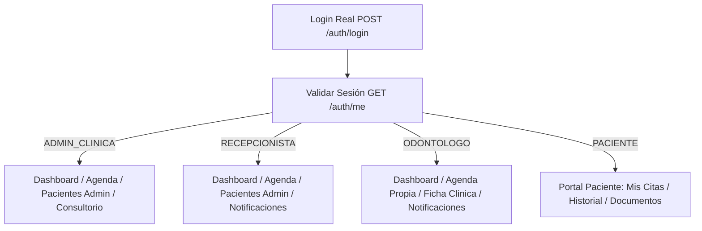

# CORONYX - Entregable F00-B: Rutas Activas, Estructura de Integración e Inventario Frontend

**Fecha:** 10 de octubre de 2026  
**Responsable:** Desarrollador B (Frontend y Vistas de Integración)  
**Versión de Roadmap:** v2.0 · F00 Preparatorio  
**Estado:** Documentado y Acordado para Desarrollo  

---

## 1. Línea Base y Diagnóstico del Frontend

- **Tecnologías:** React 19, TypeScript 5.7, Vite 8.2.2, Tailwind CSS 4 (`@tailwindcss/vite`).
- **Verificación de Compilación:**
  - `npm run build`: Exitoso (Vite genera bundle sin errores).
  - `npx tsc --noEmit`: Exitoso (0 errores de tipado).
- **Servidor de Desarrollo:** En ejecución en `http://localhost:5173`.
- **Compromiso Arquitectural:** Cero dependencias nuevas; UI en español; prohibido crear flujos paralelos o utilizar pantallas alternas que no correspondan a las rutas oficiales.

---

## 2. Censo de Rutas Activas vs. Componentes Alternos / Huérfanos

Se inspeccionó [AppRouter.tsx](file:///c:/Users/USER/Desktop/CoronyxProyecto/Frontend_Dentista/src/routes/AppRouter.tsx) y el directorio `src/pages/`. Se identificaron los componentes que gobiernan las rutas reales y los archivos huérfanos que **no deben integrarse ni modificarse en los flujos principales**:

| Ruta en `AppRouter.tsx` | Componente Oficial Gobernador | Estado en el Incremento | Observaciones de Integración |
|---|---|---|---|
| `/` | `LandingPage.tsx` | Activo (Público) | Portal informativo general. |
| `/login` | `Login.tsx` | Activo (Público) | Punto de autenticación. Pendiente retirar mocks y conectar a `/api/v1/auth/login`. |
| `/sin-acceso`, `/403` | `Unauthorized.tsx` | Activo (Público) | Vista estándar de denegación RBAC. |
| `/app/patient-portal` | `PatientApp.tsx` | **Operativo (PACIENTE)** | Shell móvil/web del portal del paciente. Pendiente conectar a API `/me`. |
| `/app/dashboard` | `Dashboard.tsx` | **Operativo (STAFF)** | Panel de resumen para Administrador, Recepcionista y Odontólogo. |
| `/app/agenda` | `Agenda.tsx` | **Operativo (STAFF)** | Agenda interactiva y turnos. Gobierna la ruta oficial de calendario. |
| `/app/pacientes` | `PacientePerfil.tsx` | **Operativo (STAFF)** | Expediente de paciente. **Atención:** Administrador debe incluirse en la ruta. |
| `/app/notificaciones` | `components/features/Notificaciones.tsx` | **Operativo (STAFF)** | Bandeja transaccional de avisos de citas. |
| `/app/consultorio` | `Consultorio.tsx` | **Operativo (ADMIN)** | Configuración de sede y gestión de personal/cuentas. |
| `/app/teleodontologia` | `Teleodontologia.tsx` | **Fuera de Incremento** | Teleconsulta excluida; apartar de menús operativos. |
| `/app/inventario` | `Inventario.tsx` | **Fuera de Incremento** | Gestión de insumos excluida; apartar de menús operativos. |
| `/app/caja` | `Caja.tsx` | **Fuera de Incremento** | Facturación y caja excluida; apartar de menús operativos. |
| `/app/super-admin` | `SuperAdminPortal.tsx` | **Fuera de Incremento** | Plataforma SaaS global; apartada sin lógica operativa. |

### Componentes Alternos Huérfanos (Identificados para evitar duplicación):
1. **`AgendaUpdated.tsx`:** Archivo alterno en `src/pages/`. **NO se usa en ninguna ruta.** La ruta `/app/agenda` importa exclusivamente `Agenda.tsx`.
2. **`Patients.tsx`:** Archivo alterno en `src/pages/`. **NO se usa en ninguna ruta.** La ruta `/app/pacientes` importa exclusivamente `PacientePerfil.tsx`.
3. **`Radiografias.tsx`:** Archivo alterno en `src/pages/`. La gestión de radiografías activa se encuentra integrada como pestaña dentro de `PacientePerfil.tsx` y `PatientApp.tsx`.
4. **`components/features/Odontogram.tsx`:** Componente 2D desacoplado para ser integrado en la fase F08 sobre `PacientePerfil.tsx`.

---

## 3. Módulos Fuera del Incremento a Apartar de la Navegación Activa

Para cumplir estrictamente con el alcance acordado (sin IA/voz, ML, teleconsulta, caja, pagos, inventario ni Super Admin):

1. **`DashboardLayout.tsx`:**
   - En `ROLE_MODULES`, retirar `'teleodontologia'`, `'caja'` e `'inventario'`.
   - Retirar el botón flotante del asistente de voz / IA (`{showAI && role === 'ODONTOLOGO' && <AIAssistant ... />}`).
2. **`PatientApp.tsx`:**
   - Retirar las pestañas `'pagos'` y `'tele'`.
3. **Regla de Conservación:**
   - Los archivos correspondientes (`Teleodontologia.tsx`, `Caja.tsx`, `Inventario.tsx`, `SuperAdminPortal.tsx`, `AIAssistant.tsx`) se conservan intactos en el repositorio para fases posteriores, pero quedan totalmente desvinculados de los recorridos operativos del personal y los pacientes.

---

## 4. Inventario Exhaustivo de Mocks de Negocio a Eliminar por Fase

Se identificó la presencia exacta de datos simulados y accesos ficticios en el código fuente actual:

### 4.1 En Autenticación y Sesión (`Login.tsx` y `AuthContext.tsx`)
- **`DEMO_ACCOUNTS` en `Login.tsx` (L14-20):**  
  Credenciales estáticas con dominios `@coronyx.co` y contraseñas fijas (`demo1234`).
- **Fallback en Captura de Error (L183-197):**  
  Si el backend falla o la API está caída, el sistema busca en `DEMO_ACCOUNTS` y abre sesión de manera ficticia.
- **Generación de Usuario Dummy en `AuthContext.tsx` (L70-85):**  
  La función `login(role)` crea un objeto `demoUser` con ID `demo-${role}` y lo persiste en `localStorage`.
- **Falsa Autorización por `localStorage` (L27-29 y L37):**  
  El estado de autenticación se valida simplemente como `Boolean(role || user?.rol)` leyendo `coronyx_role` de `localStorage` sin comprobar un JWT en el servidor.
- *Acción F02-B:* Eliminar `DEMO_ACCOUNTS`, eliminar el fallback en `catch`, e implementar revalidación de sesión vía `GET /api/v1/auth/me`.

### 4.2 En Expediente de Pacientes (`PacientePerfil.tsx` e `HistoriaClinica.tsx`)
- **Array `PATIENTS` en `PacientePerfil.tsx` (L46-55):**  
  8 registros ficticios colombianos con EPS, moneda COP y saldos.
- **Array `MOCK_HC` en `HistoriaClinica.tsx` (L12-62):**  
  Historias clínicas simuladas en memoria para pacientes 1 a 4.
- **Dictado Ficticio de IA (L78-80 en `HistoriaClinica.tsx`):**  
  Simulación con `setTimeout(..., 1800)` que agrega texto prefijado `"IA: Sin hallazgos patológicos adicionales"`.
- **Límites Rígidos de Fecha de Nacimiento en `getDobLimits` (L120-129):**  
  Fuerza una edad mínima de 5 años y máxima de 100 años en el cliente.
- *Acción F03-B y F05-B:* Conectar exclusivamente a `/api/v1/patients`, retirar arrays estáticos, eliminar la voz simulada y habilitar atención manual real versionada.

### 4.3 En Agenda y Citas (`Agenda.tsx`)
- **Manipulación de Timestamp con Sufijo `Z` (L438-439):**  
  Se concatena `'T00:00:00Z'` a fechas locales, provocando desfasajes de 5 horas contra la zona horaria `America/Lima`.
- **Consulta de Doctores sin Contexto de Sede (L423):**  
  `fetchUsersFromApi()` obtiene todos los usuarios del sistema sin enviar `Authorization` ni filtrar por `clinicaId`.
- *Acción F04-B:* Usar fechas con offset Lima (`-05:00`), consultar odontólogos de la clínica del principal y conectar validación de slots reales.

### 4.4 En Portal del Paciente (`PatientApp.tsx`)
- **Constantes Simuladas (L35-83):**  
  `PATIENT`, `NEXT_APPT`, `APPTS`, `PAYMENTS`, `PLAN_TOTAL`, `INSTALLMENTS`, `TREATMENTS`, `DOCUMENTS`, `DOCTORS`, `TIME_SLOTS`.
- **Solicitud de Cita con Éxito Artificial (L94-97):**  
  Envío simulado que ejecuta `setTimeout(() => onClose(), 2000)` fingiendo confirmación.
- *Acción F04-B y F07-B:* Consumir citas del principal autenticado y solicitudes persistidas en base de datos.

### 4.5 En Configuración de Usuarios (`Consultorio.tsx`)
- **Array `USERS_INIT` (L27-35):**  
  Personal simulado con rol no autorizado `ASISTENTE`, IDs numéricos (`1` a `7`) y moneda `COP`.
- *Acción F03-B:* Reemplazar por CRUD real contra `/api/v1/clinic/users`.

---

## 5. Recorrido por Cada Rol y Brechas por Contrato

### 5.1 Rol: `ADMIN_CLINICA`
- **Ruta de Entrada:** `/app/dashboard`.
- **Recorrido Operativo:**
  1. *Dashboard:* Métricas de citas y pacientes de su sede (sin datos clínicos).
  2. *Agenda:* Consulta y gestión del ciclo de citas de toda la clínica.
  3. *Pacientes (Brecha Detectada):* **`AppRouter.tsx` L92 actualmente restringe `/app/pacientes` a solo `ODONTOLOGO` y `RECEPCIONISTA`.** En F02/F03 debe habilitarse `ADMIN_CLINICA` para administrar la ficha de pacientes (alta, edición, archivo demográfico).
  4. *Consultorio:* CRUD de membresías de personal (`ADMIN_CLINICA`, `RECEPCIONISTA`, `ODONTOLOGO`) y datos de la clínica.
- **Campos Faltantes por Contrato:** Identificador de membresía `usuarioClinicaId`, estado activo/inactivo de cuentas, aislamiento estricto de DTO administrativo (no recibir historia clínica, odontograma ni radiografías).

### 5.2 Rol: `RECEPCIONISTA`
- **Ruta de Entrada:** `/app/dashboard`.
- **Recorrido Operativo:**
  1. *Dashboard:* Citas del día e indicadores de recepción.
  2. *Agenda:* Agendamiento, confirmación, reprogramación, cancelación y registro de asistencia (`ASISTIO` / `NO_SHOW`).
  3. *Pacientes:* Alta y actualización de información demográfica y de contacto.
  4. *Notificaciones:* Avisos de confirmación de citas y solicitudes de pacientes.
- **Campos Faltantes por Contrato:** Recepción de DTO administrativo puro; resolución atómica de solicitudes de reprogramación emitidas por pacientes.

### 5.3 Rol: `ODONTOLOGO`
- **Ruta de Entrada:** `/app/dashboard`.
- **Recorrido Operativo:**
  1. *Dashboard:* Citas y atenciones propias del día.
  2. *Agenda:* Visualización de turnos asignados a su persona (`usuarioClinicaId`).
  3. *Pacientes:* Acceso al expediente clínico completo del paciente atendido (resumen, historia clínica manual versionada, odontograma y radiografías).
  4. *Notificaciones:* Avisos clínicos.
- **Campos Faltantes por Contrato:** Manejo de estados de atención (`BORRADOR` vs. `CONFIRMADO`), versionamiento inmutable de la consulta médica (tabla `version_atencion_clinica`), y publicación explícita de archivos para el paciente (`es_visible_paciente = true`).

### 5.4 Rol: `PACIENTE`
- **Ruta de Entrada:** `/app/patient-portal`.
- **Recorrido Operativo:**
  1. *Inicio:* Resumen de próxima cita confirmada y datos de la clínica.
  2. *Mi Agenda:* Historial de citas pasadas y turnos futuros; confirmación de intención de asistir; solicitud formal de reprogramación.
  3. *Documentos:* Descarga de recetas, radiografías y consentimientos expresamente compartidos.
  4. *Mi Perfil:* Edición de datos demográficos y de contacto propios permitidos.
- **Campos Faltantes por Contrato:** Resolución de identidad ligada a `paciente.usuario_id` sin enviar IDs por cliente; consumo de endpoints propios `/api/v1/me/**`.

---

## 6. Contrato de IDs, Sesión y Errores (Frontend B ↔ Backend A)

1. **Contrato de IDs (Decimal String):**
   - Todos los tipos TypeScript (`Patient.id`, `Appointment.id`, `User.id`, `clinicaId`, `usuarioClinicaId`) deben tiparse como `string`.
   - Prohibido el uso de `Number(id)` o `parseInt(id, 10)`. En comparaciones y parámetros de URL se manejan cadenas decimales idénticas a las devueltas por PostgreSQL.
2. **Cliente HTTP Centralizado y Gestión de Sesión:**
   - Creación de un servicio HTTP base que inyecte automáticamente el header:
     `Authorization: Bearer <coronyx_jwt_token>`
   - Interceptor ante respuestas HTTP `401 Unauthorized`:
     - Limpia `coronyx_jwt_token`, `coronyx_user` y `coronyx_role`.
     - Redirige de inmediato a `/login` sin crear bucles en el historial.
   - Revalidación obligatoria de sesión mediante `GET /api/v1/auth/me` al cargar la aplicación o refrescar el navegador.
3. **Manejo Honesto de Estados de Carga y Errores:**
   - Si la API falla, la interfaz muestra el estado de error correspondiente con mensaje explicativo, sin recurrir a datos demo ni simular éxitos.
   - Manejo de estados `loading` (esqueletos/spinners), `error` (alertas con opción de reintentar) y `empty` (mensajes contextuales de "No hay registros").

---

## 7. Plan de Prioridades de Integración Frontend

- **Paso 1 (F01-B):** Adaptar `types/appointment.ts`, `services/patientService.ts`, `services/appointmentService.ts` y `services/authService.ts` al contrato de IDs en formato `string` decimal positivo; verificar que no existan operaciones destructivas con `Number/parseInt`.
- **Paso 2 (F02-B):** Eliminar `DEMO_ACCOUNTS` y el fallback de `Login.tsx`/`AuthContext.tsx`. Implementar cliente autenticado con `GET /api/v1/auth/me`. Habilitar el rol `ADMIN_CLINICA` en la ruta `/app/pacientes` de `AppRouter.tsx` y en el sidebar de `DashboardLayout.tsx`.
- **Paso 3 (F03-B):** Integrar `PacientePerfil.tsx` y `Consultorio.tsx` con persistencia real para administración de pacientes y cuentas de personal.
- **Paso 4 (F04-B):** Integrar `Agenda.tsx` y la sección de turnos de `PatientApp.tsx` con citas reales, fechas con offset Lima y resolución de conflictos `409`.
